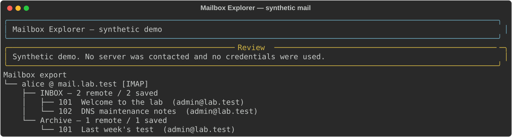

# Service Explorer

An **IMAP/POP3 mailbox browser and exporter** and a **DNS explorer**, with readable terminal tables and standalone HTML reports.

Mail export turns explicitly supplied account logins into a local tree: account → mailbox → message → original email, readable text, metadata and attachments. It handles IMAP tags and connections for you. DNS queries go to the **specific server IP you provide**, preserving response codes, record sections and transport details.

## Install

Requires Python 3.10+:

```bash
git clone https://github.com/git-vac/service-explorer.git
cd service-explorer
python -m venv .venv
source .venv/bin/activate
# Windows PowerShell instead: .\.venv\Scripts\Activate.ps1
python -m pip install .
```

Use systems/accounts you own or are authorized to examine. This is an explicit-account client, not an account-discovery or password-guessing tool. Server addresses alone do not give access to inboxes.

## Try without contacting a server

```bash
service-explorer mail demo --out exports/demo-mail
service-explorer dns demo --html reports/demo-dns.html
```

Open `exports/demo-mail/index.html` to browse the mail tree and `reports/demo-dns.html` for DNS results. All demo messages, addresses and records are invented. [DNS example](examples/dns-report.html) · [Mailbox example](examples/mail-demo/index.html) · [Walkthrough](docs/walkthrough.md)



## Mailbox export

Copy `examples/accounts.example.json` to the Git-ignored `accounts.json`, then set your server's host, protocol, security, port and username. Each entry supplies one known login, with either `password_env` (the name of an existing environment variable) or a hidden interactive password prompt. Plain `password` fields are refused. Do not put real passwords on the command line or into committed configuration.

```bash
service-explorer mail export --accounts accounts.json --out exports/mail
```

The export directory must be new. You receive a terminal account/mailbox/message tree, `index.html`, and `summary.json`. Every mailbox also has `index.csv` and `mailbox.json`. Every saved message has `message.eml`, `message.txt`, `metadata.json`, and any decoded attachments.

| Behavior | Detail |
| --- | --- |
| IMAP | Discovers selectable folders, uses read-only EXAMINE and UID-based BODY.PEEK retrieval. Does not issue STORE, CLOSE or EXPUNGE. |
| POP3 | Retrieves the account's single maildrop. POP3 does not expose IMAP folder hierarchies. Does not issue DELE. |
| Local files | Local edits, moves and deletions do not synchronize back to the server. |
| Counts | Shows remote listed count and saved count separately; skipped messages and failures stay visible. |
| Limits | Default 1,000 messages per mailbox; `--max-messages` allows 1–10,000. Messages/long protocol responses have a 10 MiB limit. |
| Identifiers | IMAP UID + mailbox UIDVALIDITY in metadata; POP3 UIDL when supported, otherwise session-local numbers. |
| Transport | TLS by default; `starttls` upgrades before authentication; `plain` must be explicitly selected. Failed TLS never falls back to plaintext. |

Folder and attachment filenames are converted to portable names with a stable hash; metadata retains original names. IMAP modified UTF-7 names are currently retained in their wire representation. HTML-only bodies get a basic plain-text extraction; scripts/styles are omitted and original HTML stays in `.eml`. Inline resources without attachment names/disposition remain in `.eml`. Message HTML and attachments are never executed or rendered by the generated browser.

For a private certificate authority, set `ca_file` in the account entry to your CA certificate. `insecure: true` explicitly disables certificate verification and produces a warning. Certificate details may be unavailable when verification is disabled. A plaintext connection is also explicitly warned about.

Interrupted exports can contain partial files. There is no resume or overwrite mode; use a new directory. The summary records per-account failures, and one failed account does not prevent the next supplied account from being attempted. A changing server mailbox is not an atomic snapshot. Exported files can contain sensitive mail; keep them in the Git-ignored `exports/` directory.

## Inspect mail service without logging in

```bash
service-explorer mail inspect --host mail.example.test --protocol imap --security starttls --html reports/imap.html
service-explorer mail inspect --host mail.example.test --protocol pop3 --security tls --port 995
```

Displays greetings, capabilities and available TLS certificate metadata. On STARTTLS connections it requests capabilities after the upgrade. This inspection does not inspect inboxes or establish whether authentication will succeed.

## DNS investigation

```bash
service-explorer dns probe --server 192.0.2.53 --domain example.test --html reports/dns.html
service-explorer dns probe --server 192.0.2.53 --domain example.test --types A,AAAA,MX,NS,SOA,TXT --json reports/dns.json
service-explorer dns probe --server 192.0.2.53 --domain example.test --wildcard --axfr
```

Replace documentation addresses with your server's address and domain. The last command explicitly requests two random-label wildcard controls and a zone transfer. Neither is performed by default. AXFR stays on the chosen server and is limited to 2,000 records and a bounded lifetime.

Optional `--names-file names.txt` queries up to 250 additional **complete DNS names** against that same server, using the selected record types. It doesn't resolve discovered names through a public resolver or automatically scan their addresses. Supported types: A, AAAA, CNAME, MX, NS, SOA, TXT, SRV, PTR and CAA. Supply reverse DNS names explicitly for PTR queries.

`--recursive` sets the recursion-desired flag; the default does not request recursion. Replies preserve answer, authority and additional records plus response flags. Truncated UDP replies are retried over TCP. Timeouts are errors, not “no record”; an empty NOERROR answer needs interpretation in context. Random-label A responses suggest wildcard or synthesized answers, not proof that every discovered name is a false positive.

## Outputs and exits

Terminal output is the default. Mail exports always include a local HTML browser and JSON summary; DNS/inspection add `--html FILE` and `--json FILE`. HTML is self-contained, escapes collected text and loads no scripts or external assets. Use `service-explorer --no-color ...` or `NO_COLOR` for plain terminal rendering. Output files/directories must be new.

Exit 0: collection completed, including legitimate DNS negative answers. Exit 1: partial collection/export. Exit 2: invalid input, connection/setup or output failure. Exit 130: interrupted. These are operation results, not security verdicts. DNS REFUSED/SERVFAIL are preserved as response codes; they are not findings of absence.

## Tests

```bash
python -m pip install -e .
python -m unittest discover -s tests -v
```

Tests use loopback IMAP, POP3 and DNS servers with synthetic mail. They exercise actual protocol requests, read-only mail retrieval, UDP→TCP fallback, negative DNS responses, path protection, HTML escaping and output protection. No real mail accounts or external targets are used. CI runs on Linux and Windows with Python 3.10 and 3.12.

References: [Python IMAP client](https://docs.python.org/3/library/imaplib.html), [Python POP3 client](https://docs.python.org/3/library/poplib.html), [IMAP protocol](https://www.rfc-editor.org/rfc/rfc9051.html), [POP3 protocol](https://www.rfc-editor.org/rfc/rfc1939.html), [dnspython](https://dnspython.readthedocs.io/). MIT licensed.
